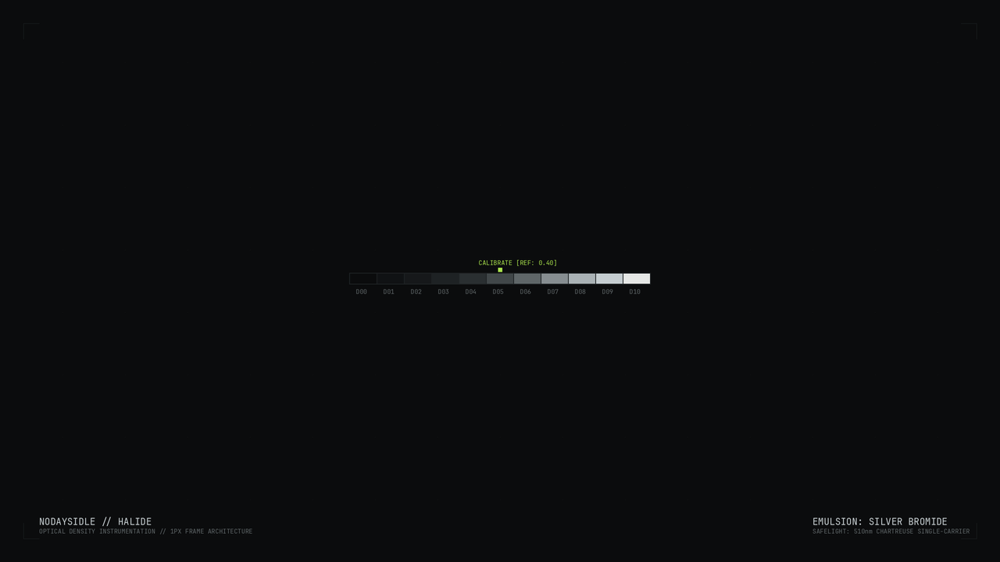

# nodaysidle Halide — Omarchy Theme

> *"The anti-thesis of every rounded-glass theme in the portfolio: neutral cold greys, hard 1px rules, and exactly one colour allowed to exist — a chartreuse safelight. Everything else is silver and soot."*

A photographic darkroom instrument panel for **Omarchy / Hyprland**, custom-tailored for the **nodaysidle** workspace. Built for deep focus, reading diffs, scanning logs, and terminal hacking without soft visual distractions or deceptive blue-black tinting.



---

## Design System & Color Tokens

Anchored in a pure neutral soot ground with silver structural frames and a solitary chartreuse safelight signal:

| Token | Hex | Role in Ecosystem |
| :--- | :--- | :--- |
| **Darkroom Void** | `#0B0C0D` | Primary background (true neutral, zero blue-black cast) |
| **Fixer Black** | `#060708` | Popovers, lockscreen background, sunken containers |
| **Plate Raise** | `#16181A` | Elevated surfaces, menu cards, container grounds |
| **Rule Grey** | `#1E2224` | Inactive borders, bar divider, separating hairlines |
| **Silver** | `#C6CED1` | Active borders, window structures, headings, frames |
| **Lime Safelight** | `#A9E34B` | Signal only: active workspace, cursor block, focus indicators |
| **Halide Cyan** | `#6FD3C7` | Telemetry info, links, secondary signals |
| **Amber Stop** | `#D9B451` | Warning alerts |
| **Oxide Red** | `#E05F5F` | Error states, failed authentications |
| **Paper** | `#E6E8E6` | Primary typography (calibrated with faint green cast) |
| **Fog** | `#5F6668` | Muted labels, secondary metadata, code comments |

---

## Key Architectural Features

### 1. Brutalist 1px Plate Geometry
- **Flat Silver Borders**: Exactly 1px flat silver (`#C6CED1`), completely eliminating gradients and animations.
- **Glass Plate Corners**: Set to `rounding = 2` with `rounding_power = 1.0` — windows render as crisp glass plates on an inspection table rather than rounded cards.
- **Subtle Inactive Frames**: Inactive windows drop to `rgba(1E2224FF)` (Rule Grey), making non-focused panes read as clean sheets on a lightbox rather than a cluttered cage of frames.
- **Crisp Optical Shadow**: Hard, tight drop shadows (`range = 10, render_power = 3`), mirroring how photographic prints cast sharp physical shadows.

### 2. The Lightbox Discipline (`dim_inactive = 0.40`)
Halide enforces an uncompromising `dim_inactive = 0.40` strength. Unfocused windows immediately recede into the soot background, illuminating only the active surface under inspection.

### 3. Mechanical Shutter Motion
Nothing eases softly; nothing overshoots or bounces:
- **`shutter` Bezier**: Points `(0.20, 0.0, 0.0, 1.0)` cut into place like a mechanical focal-plane shutter firing.
- **Window Spawn & Dismiss**: `windowsIn` snaps at speed `8.0` (`popin 96%`); `windowsOut` clears at speed `6.0`.
- **Window Movements**: `windowsMove` tracks at speed `6.0` with the mechanical shutter curve.
- **Layer Transitions**: Fast fade at speed `3.0`.
- **Border Animations**: `borderangle` animation is strictly disabled — there is nothing to rotate on a 1px brutalist rule.

### 4. 22px Film Strip Status Bar
Configured via `shell.toml` for maximum information density:
- **Ultra-Slim Profile**: 22px height — the thinnest bar in the Omarchy ecosystem.
- **Flat Void Surface**: Flat `#0B0C0D` at 100% opacity, bordered by a single 1px `#1E2224` rule beneath.
- **Numeric Workspaces**: Workspaces display as two-digit numerals (`01`, `02`, `03`, ...), active highlighted in Lime (`#A9E34B`), occupied in Silver (`#C6CED1`), and empty in Dim Grey (`#2A2F31`).
- **Monospace Telemetry**: Uppercase monospace date and clock (`%a %d %b  %H:%M`).

### 5. Ghostty & Herdr Cockpit Integration
Configured exclusively for **Ghostty** and the **Herdr** agent workspace multiplexer:
- **Ghostty**: Custom `ghostty.conf` with `#0B0C0D` void ground, `#E6E8E6` paper text, `#A9E34B` chartreuse lime block cursor, and full ANSI darkroom calibration.
- **Herdr**: Seamlessly matches through `theme = "Omarchy"` (GPUI) and `theme.name = "terminal"` (TUI), inheriting telemetry highlights across active agents and pane splits.
- **Solid Window Opacity**: Strict `1.0 1.0` opacity rules across terminals and browsers for pure contrast and 120Hz rendering performance.

---

## Curated High-Resolution Wallpapers

Includes 3 bespoke 2560×1440 wallpapers generated specifically for the Halide darkroom aesthetic:

1. `01-halide-darkroom-void.png` — Darkroom void ground with 1px silver reticle grid, D00–D10 optical density calibration scale, and neutral reference marker.
2. `02-halide-safelight-slit.png` — Monochromatic optical slit with sharp 510nm chartreuse safelight carrier wave and technical calibration markings.
3. `03-halide-contact-sheet.png` — 35mm contact sheet layout with film sprocket perforations, frame number indices (`▲ 12A`), and chemical process telemetry.

---

## Trade-Off, Stated Plainly

This is the least forgiving theme in the suite. At 0.40 dimming and 1px frames, a busy multi-window workspace looks starker than softer themes like Kiln or Tide, and demands a monospace-first workflow. That is entirely deliberate: it is the theme engineered for reading diffs, scanning logs, and writing code with absolute clarity.

---

## Installation & Activation

### 1. Register the Theme
Clone and run the installer from inside the repository:

```bash
git clone https://github.com/nodaysidle/omarchy-theme-nodaysidle-halide.git
cd omarchy-theme-nodaysidle-halide
chmod +x install uninstall hooks/nodaysidle-halide
./install
```

### 2. Activate with Omarchy
```bash
omarchy theme set nodaysidle-halide
```

### 3. Cycle Wallpapers
```bash
omarchy theme bg next
```
*(or press `Super + Ctrl + Space` for the visual wallpaper picker)*

---

## File Architecture

```
omarchy-theme-nodaysidle-halide/
├── colors.toml               # Master color tokens for Omarchy templates
├── hyprland.lua              # 1px flat silver rules, shutter curve, 2px corner plates
├── shell.toml                # 22px film strip bar, numeric workspaces, popups & OSD
├── ghostty.conf              # Ghostty terminal palette & chartreuse block cursor
├── btop.theme                # Monochrome darkroom telemetry monitor skin
├── gtk.css / gtk3.css        # Hard square GTK plates with zero border radius
├── gum.env.conf              # Terminal dialog & prompt styling
├── hyprlock.conf             # Flat 1px silver lock screen with numeric monospace clock
├── preview.png               # High-resolution screenshot for Omarchy theme picker
├── install / uninstall       # Symlink & hook registration scripts
├── hooks/
│   └── nodaysidle-halide     # Omarchy theme-set lifecycle hook
└── backgrounds/              # Bespoke 2560×1440 darkroom instrument wallpapers
    ├── 01-halide-darkroom-void.png
    ├── 02-halide-safelight-slit.png
    └── 03-halide-contact-sheet.png
```

---

## Built for NODAYSIDLE
Part of the [nodaysidle](https://github.com/nodaysidle) workspace — relentless shipping, zero compromise.
